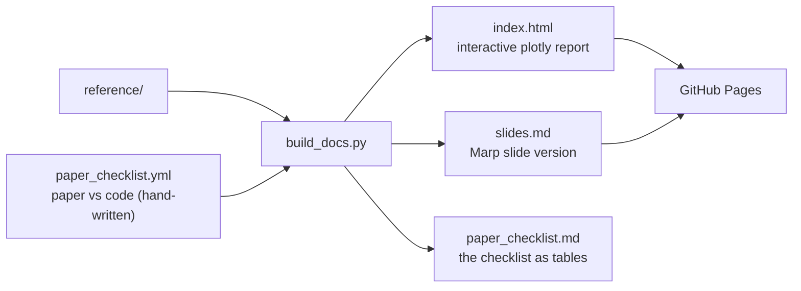

# `docs/`: visual summaries

Generated by `scripts/build_docs.py` from `reference/` and `paper_checklist.yml` (run by
`scripts/freeze_reference.py`; never edit the generated files by hand). Published to GitHub Pages with the slides: `report.html` and
`summary.html`.

| File | Is |
| --- | --- |
| `index.html` | the report: scorecard, distance of each reproduction from its paper, which model gaps are real, mortality seeds vs the published run, reserving; details expand; model version, data used, reproduce commands and links to the running systems |
| `slides.md` | the same story as a Marp deck |
| `paper_checklist.yml` | the source, written by hand: for each model, every component of its benchmark paper (architecture, equations, hyperparameters, data handling), where the paper states it, and whether our code matches, deviates (with the reason) or the source is silent. `pytest` checks each quoted parameter and symbol against `conf/base` and the code |
| `paper_checklist.md` | that checklist as one table per model |
