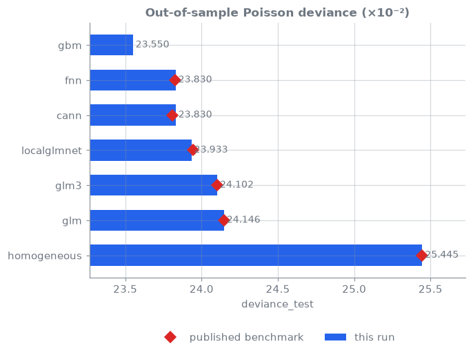
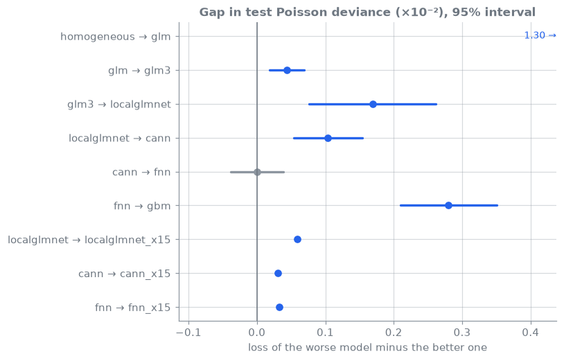

# Deep actuarial science: benchmark summary

Model version **0.3.0**, commit `184d494`, frozen 2026-11-16.
Full interactive report: `docs/index.html`.

---

## Scorecard: 25 PASS, 4 FAIL

- **cann** deviance_learn: ours 23.78, paper 23.74
- **cann** deviance_test: ours 23.83, paper 23.81
- **cann** epochs: ours 52.67, paper 90
- **lstm** rmse_out: ours 0.5531, paper 0.3559

---

## Is the book's single mortality run typical?

| Network | Published | Our 15 seeds | Published run is |
| --- | --- | --- | --- |
| cnn | 0.3531 | 0.344–0.623 | inside the seed range |
| cnn_tanh | 0.3189 | 0.312–0.507 | inside the seed range |
| lstm | 0.3559 | 0.434–0.716 | better than every seed |
| transformer | 0.3624 | 0.366–1.134 | better than every seed |

---

## Which gaps are real?

---

## Implemented as in the paper?

**44** components as in the paper, **7** documented deviations,
**9** where the source is silent or not yet read.

- **FNN with embeddings**, seeds and splits: Keras and PyTorch draw different numbers from the same seed, so the paper's runs cannot be redrawn; the benchmark compares the two 15-seed means instead.
- **FNN with embeddings**, loss: Same minimiser; the two differ by a constant and a scale that nadam's normalisation removes (up to epsilon).
- **LocalGLMnet**, start of the attention layer: The GLM start is Brauer's (2024, Sect. 4.2); training then starts from the GLM's fit.
- **LocalGLMnet**, final scaling layer: The scale can be absorbed into the attention layer, so the model class is the same.
- **LocalGLMnet**, runs: Fifteen seeds give the spread the single published run is checked against.
- **CNN, non-linear CNN, LSTM, Transformer**, learning-rate plateau: With the absolute threshold every network underfits (CNN in-sample RMSE 0.241 against the book's 0.2108; relative 0.206), so the book's runs did not decay that way.
- **CNN, non-linear CNN, LSTM, Transformer**, runs: PyTorch cannot redraw Keras's seed; the published run is checked against our 15 seeds.

Every component: `docs/paper_checklist.md`.

---

## Data, reproduce, systems

- Data: freMTPL2; Swiss HMD; CAS Schedule P (Meyers' 50 companies)
- Reproduce: `git checkout 184d494`, then `scripts/full_run.sh reference`
- [Repository](https://github.com/actuarialsociety/deep-actuarial-science) · [Wiki](https://github.com/actuarialsociety/deep-actuarial-science/wiki) · [CI](https://github.com/actuarialsociety/deep-actuarial-science/actions) · MLflow: `mlflow ui`
